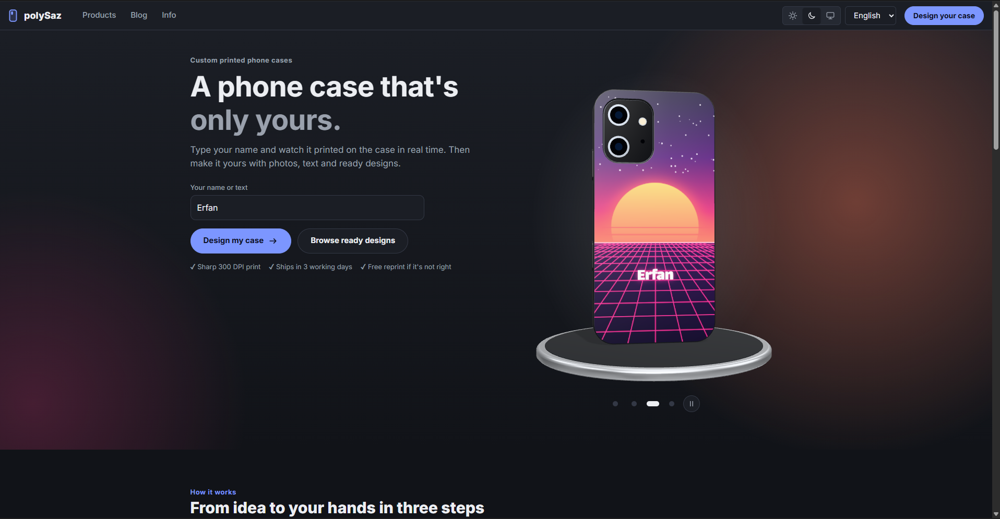
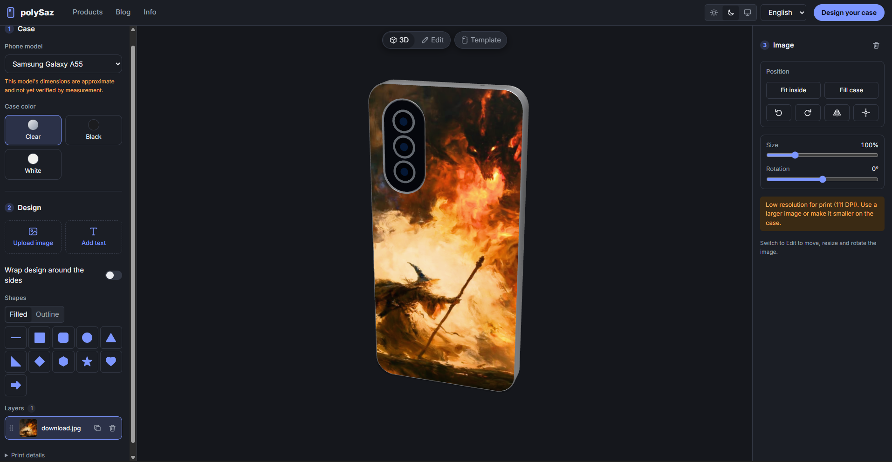

# PolySaz

**Design your own phone case in the browser and see it in live 3D before you order.**

PolySaz is a storefront and phone-case designer. Add text, shapes and images on a 2D canvas, and the design wraps onto a real-time 3D model of the case. The site is bilingual: Persian (RTL, default) and English (LTR).





## Features

- **Case designer**: text, shapes, images, colors and layers on a Fabric.js canvas
- **Live 3D preview**: the design is rendered onto a Three.js case model as you edit
- **Print zones**: the design is kept inside the printable area of each phone model
- **Storefront**: home page with a 3D hero, product catalog, blog and info pages
- **Bilingual**: Persian and English, with RTL/LTR layout, localized numbers and Persian calendar dates
- **Themes**: light and dark mode

## Tech stack

| Area | Tools |
| --- | --- |
| Framework | Angular 22, RxJS |
| 2D editor | Fabric.js |
| 3D | Three.js, three-mesh-bvh, three-bvh-csg |
| Styling | Tailwind CSS 4, SCSS |
| i18n | Transloco |
| Tests | Vitest |

## Getting started

Requirements: Node.js and npm.

```bash
npm install
npm start
```

Open http://localhost:4200.


## Adding a translation

1. Add the language to `src/app/core/i18n/languages.ts`
2. Add `src/assets/i18n/<code>.json` with the same keys as `en.json`
